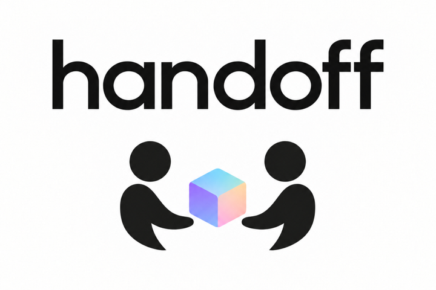
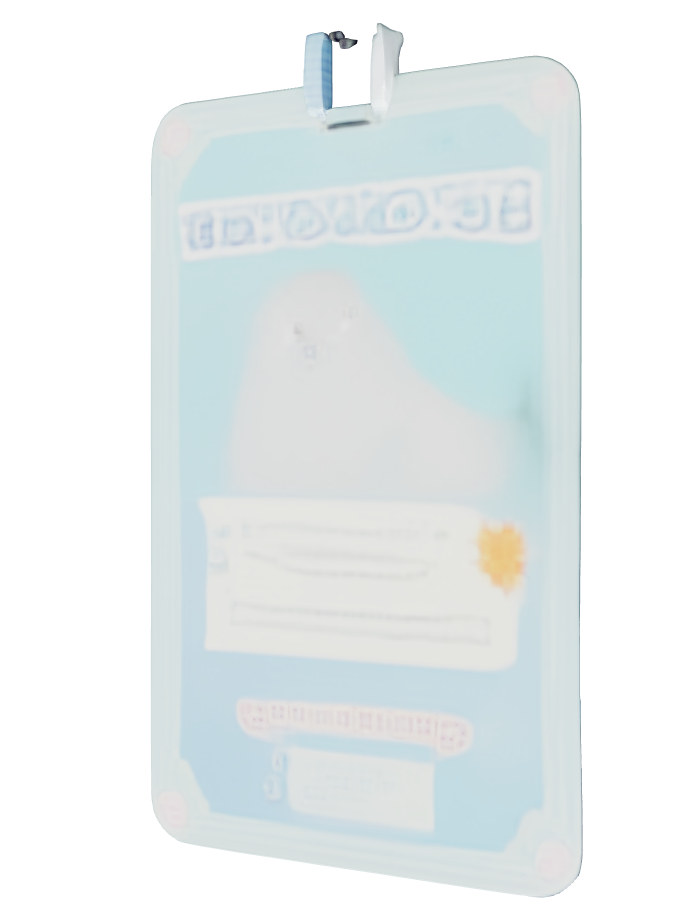
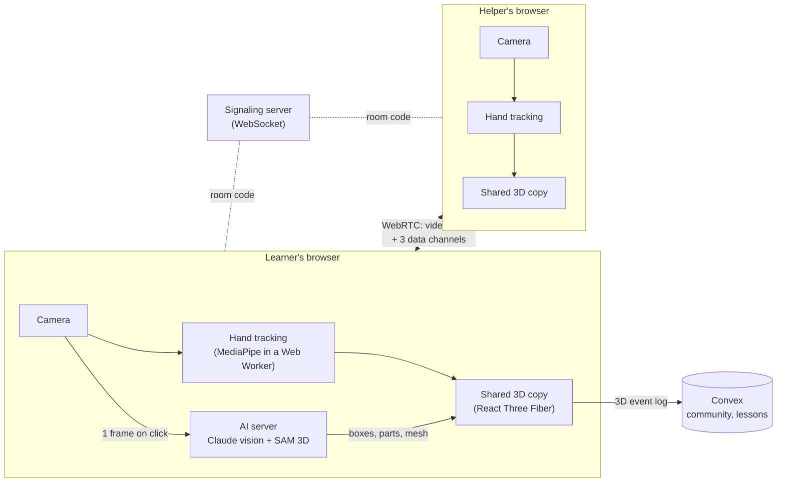

<div align="center">



### Hand someone your problem, not your screen.

Remote help for physical things, from people who know how. Post what you're stuck on, get matched with a helper from the community, and on the call your object becomes a 3D copy that both of you can grab, turn and take apart with your real hands. Every session is saved as a 3D lesson you can replay from any angle.

<p>
  
  
  
  
</p>
<p>
  
  
  
  
</p>

<sub>Built at Cal Hacks 13</sub>

</div>

<br />

## The problem

Video calls are great for faces and terrible for things.

"Press the little button on the left." *Which left? Yours or mine?* "No, the other one." Anyone who has helped a parent set up a router, talked a friend through changing a bike tube, or tried to fix a printer over FaceTime knows the feeling. The camera flattens the object, the helper can't touch it, and the person who needs help is left holding a phone in one hand and the problem in the other.

## The idea

Handoff turns the object itself into the shared space.

<table>
<tr>
<td width="33%" align="center"><h3>1. Click it</h3>Hold your object up on the call. Claude finds every object in view and puts a box around each one. Click the one you need help with.</td>
<td width="33%" align="center"><h3>2. Hand it over</h3>It appears as a 3D copy on both screens, built from that one camera frame by Claude and Meta's SAM 3D. Your helper's tracked hands reach in and show you how.</td>
<td width="33%" align="center"><h3>3. Keep the lesson</h3>The whole demonstration is saved as a 3D replay, not a video. Scrub it, slow it down, and watch from any angle the next time you forget.</td>
</tr>
</table>

<div align="center">

<br />
<sub>A real SAM 3D mesh of our hero object, made from a single webcam frame and cut into movable parts.</sub>
</div>

<br />

## A community of helpers

The hardest part of getting help isn't the call. It's knowing who to call. Not everyone has a handy relative or a friend who knows bikes, and the people who do know often have no easy way to offer it. Handoff is built around a community where anyone can ask and anyone can help.

**Ask.** Post a request with a title, a description and a category ("Can't get the cap off my inhaler", "Lanyard clip came off my badge"). It shows up live in the public feed, or you can send it straight to a specific helper.

**Help.** Turn on availability and list what you're good at: phones, sewing, bikes, home networking, medical devices. Browse open requests, or get notified the moment someone asks you directly. Press **Accept Help** and a private conversation opens with the requester.

**Connect.** One tap on **Accept call** and both people are in a Handoff call together. No room codes to read out, no links to send. Calls are tied to the session, so only the two people in it can join.

**Build trust.** After a session, the person who was helped can rate it. Every profile shows a bio, expertise, a rating, how many different people they've helped and how many sessions they've completed. These numbers only count calls that actually connected and finished, can't be edited by the helper, and helping the same person twice doesn't inflate the count.

**Stay in touch.** Find people by username, send friend requests, chat in private messages, and invite friends straight into a call whenever you need them again. Presence shows who is online right now, across every tab they have open.

It turns one-off favors into a network: the person who got help with their phone today can be the one who teaches someone to thread a sewing machine tomorrow. And because every session is saved as a lesson, help given once keeps helping.

> Want to call someone you already know? A plain call with a six-character code still works with no account at all.

<br />

## Who it helps

| | |
|---|---|
| **Family tech support** | Grandparents and parents get help with a new phone, TV remote or router from family who live far away, without needing to describe what they see. |
| **Accessibility and health** | Child-proof pill caps, inhalers, glucose meters, hearing aid batteries. Small, fiddly objects where "push down and twist" is much easier to show than to say. |
| **Across languages** | A gesture on a shared object needs no translation. A helper and learner who share no language can still work through a task hand to hand. |
| **Repairs and field work** | A remote expert guides someone on site through a valve, a connector or a latch, and the session becomes reusable training for the next person. |
| **Teaching at a distance** | Lab equipment, instruments, crafts and assembly steps, taught with hands instead of slides, and kept as lessons students can replay. |
| **People who want to give back** | Retirees, students and hobbyists with skills to share can list their expertise, pick up requests from strangers, and build a public record of the people they have helped. |

The common thread: the person who needs help keeps their hands on the real thing, the helper gets to *show* instead of *tell*, and the knowledge doesn't vanish when the call ends.

<br />

## What's under the hood

Handoff runs entirely in the browser. There is no app to install, and it works on a laptop or a phone.



### Real-time hand tracking, off the main thread

- Google's **MediaPipe Hand Landmarker** runs on WebAssembly inside a **Web Worker**, tracking **two hands at 21 joints each**, with depth, at up to 60 FPS on desktop.
- Frames move to the worker as transferable `ImageBitmap`s with **at most one frame in flight**. A slow frame is dropped, never queued, so tracking never falls behind real time.
- Each hand keeps its own slot by position and velocity, because MediaPipe's left and right labels swap when hands cross.
- Fingertips are smoothed with a **One Euro filter**, which stays steady when the hand is still and responsive when it moves.

### Grabs that feel natural

- **Pinch** (thumb and index) takes a small part and turns it like a knob. **Grip** (thumb, index and middle) holds the whole object and follows the wrist in full 3D: roll, tilt and turn.
- Grabbing is **intent-gated**: a grab only starts when the hand was open, rested over the part for a moment, and closed slowly. A hand waving past the object never catches it.
- What your finger is touching is decided by a **ray through the fingertip**, so it stays correct however the object has been turned.
- Each hand can hold a different piece. Steady a bottle with one hand and twist the cap off with the other.

### From one camera frame to an interactive 3D object

- **Claude vision** scans the camera and returns, for every object, a bounding box, a name, and a parametric 3D model with its **moving parts** labeled (a cap that unscrews, a clasp that opens). Small objects sitting inside related larger ones are folded in as parts.
- Press **3D** and the frame goes to **Meta's SAM 3D** (via fal.ai). About 15 seconds later a real textured mesh swaps in.
- The mesh is **fitted onto Claude's model and cut into the same parts**, finding the cut where the scan itself changes color or width. SAM 3D returns one solid blob; this step is what makes its pieces movable.
- Half a million triangles are **decimated to tens of thousands** (about 5 to 12 MB down to 1 to 2 MB) and cached by name, so an object is only ever modeled once.

### The hero demo: clipping a lanyard onto its badge

A small kinematic system built for one hard, physical task:

- Grip the clasp and the badge **hangs and swings** from it as a damped pendulum.
- Pinch the clasp and the **lobster claw opens**. Lift it away and the badge stays where it hung.
- Bring the open claw near the badge's slot and it **lines itself up** and lights up. Let go and it snaps shut.
- The lanyard strap follows the clasp every frame, through carrying, swinging, unclipping and clipping back on.

### A call built for 3D, not just video

- Two people join with a **six-character room code** over a small WebSocket signaling server, then connect peer to peer with **WebRTC** and trickle ICE.
- On top of audio and video, the call opens **three data channels**, each tuned for what it carries:

| Channel | Delivery | Carries |
|---|---|---|
| `hand` | unordered, no retransmit | Both hands as a compact **262-byte binary frame**, about 30 times a second |
| `pose` | unordered, no retransmit, sequence-numbered | The 3D copy's pose and part states, so a lost packet on bad Wi-Fi never blocks the next |
| `control` | reliable, ordered | The object itself, helper mode, saved lesson ids |

- Ownership is simple and predictable: **whoever grabs first holds it** until they let go, and ties go to the person who brought it out. Your own grab uses your own camera, so it never waits on the network.
- **TURN relay support** (self-hosted coturn with short-lived HMAC credentials, or a managed provider) keeps calls working on locked-down event and campus Wi-Fi. Credentials never leave the server.

### Lessons that record themselves, as data

- A lesson starts when a 3D copy appears and saves itself when it closes. Both people get a copy in **Tutorials**.
- It is **not a video**. It is an event log of both people's hands (every joint, with depth) and every piece's pose, so it plays back in the same 3D scene: pause, scrub, 0.5x to 2x speed, and **orbit to any angle**.
- Logs go to **Convex file storage** and are validated server-side (size cap and every field decoded with the call's own decoders) before they are kept. The Tutorials list is a live reactive query.

### A real-time community backend on Convex

The whole community runs on **Convex**: accounts, profiles, requests, friendships, messages, notifications, ratings and session history. Every screen is a **reactive query**, so a new request, a reply or a helper coming online appears instantly on everyone's screen with no polling and no refresh.

- **Accounts** use **Convex Auth** with email and password. Profiles expose an explicit allowlist of public fields, so emails, auth data and private session details never leave the server.
- **Matching is transactional.** Accepting a request marks the helper busy, creates the private session, opens the conversation and sends the notifications in **one Convex transaction**. Two helpers can't accept the same request, and nobody can be double-booked.
- **Lifecycles run themselves.** A request moves from Pending to Accepted to In Session to Completed. Unanswered requests and unjoined sessions expire after 30 minutes through **scheduled functions**, and a dropped call keeps a 60-second window to rejoin before it's closed out.
- **Joining a call is verified end to end.** Community rooms use a reserved code range that can't be joined by typing a code. When someone joins, the signaling server hands their access token to Convex, which checks the JWT and confirms they belong to that session, then keeps checking during the call. It never trusts a user id or room code from the browser.
- **Presence** uses the `@convex-dev/presence` component: online status that follows every open tab and times out cleanly when someone leaves.
- **Stats can't be gamed.** Ratings and counters update inside the same transactions as session completion, one review per session, and a `helpedPairs` table makes sure helping the same person again adds a session but not a new person helped.
- Backend logic is tested with `convex-test`, including the cases that must fail: the wrong user, a duplicate accept, a third person trying to join.

<br />

## Privacy by design

- **Call video and audio are never recorded or stored.** A lesson is hand positions and object poses only.
- Camera frames stay in the browser. The only exceptions are the call itself (encrypted by WebRTC, peer to peer) and single frames sent to Claude to find objects, or to SAM 3D when someone presses **3D**.
- Hand data travels only to the other person on the call, never through a server.
- Community profiles share only what you choose to make public. Room codes never appear in the public feed, and only the two people in a session can see or join it.
- API keys and TURN secrets live on the server only.

<br />

## Getting started

**Requirements:** Node.js 20.19+ or 22.12+, and a recent Chrome, Edge, Android Chrome, or iOS Safari 17+.

```sh
npm install
npm run dev
```

Open the printed localhost URL, click **New call**, and allow camera and microphone. In a second window (or on a second device using the same server), enter the code under **Join with a code**. Use headphones when testing on one machine.

### Turn on the AI

Copy `.env.example` to `.env` and add the keys you have. Everything is optional; without them the call and hand tracking still work.

| Variable | Enables |
|---|---|
| `ANTHROPIC_API_KEY` | Claude object finding, 3D parts and the action parser |
| `FAL_KEY` | The **3D** button (SAM 3D meshes) |
| `CARTESIA_API_KEY` | Streaming speech to text for the voice agent (falls back to the browser's recognizer) |
| `TURN_URLS` + `TURN_SHARED_SECRET` | Relay for restrictive networks (see [deploy/README.md](deploy/README.md)) |

### Turn on Tutorials and Community

```sh
npm run convex           # local Convex backend, keep it running
npm run community:auth   # once: local auth keys
npm run dev
```

After the first setup, `npm run dev:community` starts everything together. Full walkthrough: [docs/COMMUNITY.md](docs/COMMUNITY.md).

### Commands

| Command | What it does |
|---|---|
| `npm run dev` | App on 127.0.0.1:5173, signaling on :8787, AI server on :8790 |
| `npm run dev:https` | HTTPS on your local network so phones can use the camera |
| `npm test` | Unit tests: coordinates, grabs, rotations, wire formats, room protocol, TURN |
| `npm run test:community` | Convex backend tests: matching, permissions, ratings, friends, messages |
| `npm run build` | Strict TypeScript check and production bundle |
| `npm run test:e2e` | Playwright: two real Chromium peers on a live call with synthetic media |
| `npm run test:e2e:relay` | The same, forced through a local coturn relay over UDP and TCP |
| `npm start` | Production server: app, signaling, AI and `/health` on one port |

<br />

<details>
<summary><b>Testing on a real phone</b></summary>

<br />

Phones only allow the camera on HTTPS, and the certificate has to be trusted by the phone itself. With [mkcert](https://github.com/FiloSottile/mkcert) (`brew install mkcert` on macOS):

```sh
mkcert -install
mkdir -p .cert
# Replace 192.168.1.42 with your laptop's Wi-Fi IP (ipconfig getifaddr en0)
mkcert -key-file .cert/localhost-key.pem -cert-file .cert/localhost.pem localhost 127.0.0.1 ::1 192.168.1.42
npm run dev:https
```

Run `mkcert -CAROOT` and copy **only `rootCA.pem`** to the phone. Never copy `rootCA-key.pem`.

- **iPhone:** install the profile in Settings, then turn on full trust under Settings › General › About › Certificate Trust Settings.
- **Android:** Settings › Security › Install a certificate › CA certificate (wording varies).

Open `https://<your-ip>:5173` on the phone. If it won't load, check your firewall and whether the Wi-Fi isolates clients.

**Checklist:** no sideways scrolling at 320 to 390 px, call controls fit in one row, hands line up in portrait and landscape, front camera mirrors and rear does not, switching cameras stops the old one, and backgrounding the tab pauses tracking.

</details>

<details>
<summary><b>Calling between two computers</b></summary>

<br />

Both people must reach **the same signaling server**. Two separate `npm run dev` instances have separate rooms.

- **Easiest:** deploy once (Render works well, see [deploy/README.md](deploy/README.md)) and both people open the same HTTPS URL.
- **Or:** run the app locally on both machines with the same `VITE_SIGNALING_URL=wss://your-server/signal` in `.env.local`.

On networks that block direct peer connections (most event Wi-Fi), add a TURN relay. With relay settings present, the server defaults to relay-only so a broken relay can't hide behind a direct connection. The call shows **TURN relay** only when WebRTC stats confirm the relay is actually in use.

</details>

<details>
<summary><b>Saving the lanyard model for the demo</b></summary>

<br />

With `npm run dev` running and `FAL_KEY` set:

1. Hold the lanyard with the badge clipped on and scan it (**⋯ › AI scan to 3D model › Scan my camera**). Pick the lanyard or the badge.
2. Press **3D**. In about 15 seconds the SAM 3D mesh replaces the simple shapes.
3. If it looks right, press **★**. This writes `public/demo/lanyard.ghm`, `lanyard.json` and `index.json`. Commit them.

From then on it ships with the app: **Saved for the demo** opens it without scanning, `?demo=lanyard` opens it on load, and no AI server is needed to show it. Other finished meshes are cached in `.cache/meshes/`, which is committed so every machine starts with them.

</details>

<details>
<summary><b>Performance and honest limits</b></summary>

<br />

- Desktop tracking runs as fast as frames arrive (capped at 60 per second). Phones cap capture at 30 FPS and 640 px, render at device pixel ratio 1, and pause when hidden.
- MediaPipe depth is a **monocular estimate**. Fists, edge-on palms, fast motion and dim light can cause jumps. Interactions are designed around this: alignment works in the screen plane and the system snaps the last few degrees for you.
- Grab and turn thresholds are first tuning passes on real hands and can be refined further.
- Camera and tracking behavior cannot be verified headlessly. Unit and browser tests cover the logic, the wire formats and real peer connections; the rest needs a person in front of a camera.

</details>

<br />

## Project layout

```
src/
  App.tsx            Call screen: camera, object boxes, helper mode, the shared 3D copy
  CallSession.ts     WebRTC peer, data channels and signaling client
  render/            3D scene, mesh fitting, the lanyard rig, lesson playback
  remote/            Hand wire format, grasp detection, two-hand slots, grab gate, rotations
  ai/                Scene cache, part folding, action parser and confidence policy
  replay/            Lesson recorder, Convex upload, Tutorials
  community/         Requests feed, helpers, activity, profiles, messages and friends
  voice/             Listening agent (Cartesia STT); built, currently switched off in the call
public/
  tracking.worker.js MediaPipe hand tracking in a worker
server/
  index.mjs          Signaling, static files, health
  turn.mjs           TURN credentials
  ai.ts              Claude and SAM 3D routes, mesh cache
convex/              Auth, matching, sessions, friends, messages, ratings, presence, lessons
```

## Learn more

- [docs/GOALS.md](docs/GOALS.md): the core loop, milestones and sponsor tracks
- [docs/ARCHITECTURE.md](docs/ARCHITECTURE.md): tracking pipeline, call protocol, assembly and replay design
- [docs/COMMUNITY.md](docs/COMMUNITY.md): accounts, requests and local Convex setup
- [docs/DESIGN.md](docs/DESIGN.md): the approved iPhone and Mac interface design
- [deploy/README.md](deploy/README.md): public server and TURN relay
- [AGENTS.md](AGENTS.md): conventions and invariants for contributors

<br />

<div align="center">
<sub>Made with two hands each at Cal Hacks 13.</sub>
</div>
